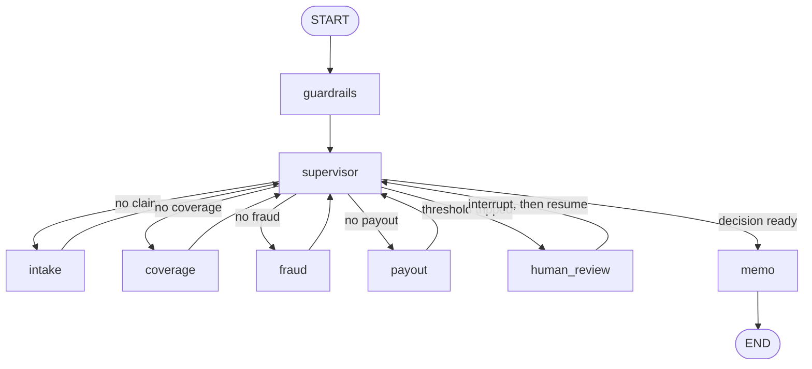

# Insurance claims agents

A supervisor-routed LangGraph workflow that turns a labeled first notice of loss into a coverage decision with verbatim quotes, a fraud score, an indemnity and reserve, and a memo. High fraud, high value, low confidence, or high-severity prompt injection pauses the thread for approve or reject.

Routing, the coverage decision, the fraud rules, and the indemnity math are code. The language model is asked for two things: extraction JSON, and one memo paragraph. Tests and CI use a deterministic fake provider, so those runs do not need an API key.

[](https://github.com/Navneethsnehal/insurance-claims-agents/actions/workflows/ci.yml)




## What it does

- **Intake.** Labeled FNOL text becomes a `ClaimExtraction`. Deductible and limit are copied from the policy declarations. A stated deductible on the notice does not change them. Loss labels such as `crash` or `Collision`, and fact tags such as `wear and tear`, are mapped onto the vocabulary the coverage engine uses.
- **Coverage.** For one policy, BM25 and 256-dimensional hashed token vectors are fused with reciprocal rank fusion. The decision is code: covered, excluded, or partial, with quotes cut from the clause text. A clause that was not in the top-k search is marked `lookup`.
- **Fraud.** A gradient-boosting model on 14 synthetic features is fused with SIU rules by `min(1, max(model, rules))`. The rule score is the heaviest single rule, not a sum. Explanations are one-feature ablations against the training median.
- **Payout.** Indemnity is `max(0, min(basis, limit) - deductible)`. When coverage confidence is below 0.8, the reserve is indemnity × 1.15. Otherwise the reserve equals indemnity.
- **Supervisor.** `choose_next` picks the next node. After payout, high-severity injection, fraud score ≥ 0.65, estimated damage ≥ $25,000, or extraction or coverage confidence < 0.55 routes to `human_review`. A zero confidence is below that line. A finished memo ends the graph. A halt still writes a memo with recommendation `refer`.
- **Human review.** The node calls LangGraph `interrupt`. Approve keeps the system indemnity. Reject forces recommendation `deny` and indemnity 0. An excluded outcome stays `deny` on approve. A resume value other than approve or reject raises `ClaimStateError` in the service before the graph is invoked.
- **Guardrails.** Email, SSN, US phone numbers (including `(214)555-0198`), labeled dates of birth, and Luhn-valid card numbers are redacted. Findings stored on the claim are kind and count. Injection spans are replaced with `[INJECTION_REMOVED]` and the file is escalated. Memo prose drops clause-shaped tokens that are not on the decision.
- **Providers.** `CLAIMS_LLM_PROVIDER` is `fake` (default), `openai`, or `anthropic`.
- **API.** FastAPI: `GET /health`, `GET /samples`, `POST /claims`, `GET /claims`, `GET /claims/{id}`, `POST /claims/{id}/resume`. The Streamlit app in `ui/dashboard.py` is a client of that API.

The corpus is three sample forms: `POL-AUTO-STD`, `POL-AUTO-PREM`, and `POL-HO-STD`. The labeled book is 17 synthetic notices in `data/samples/`.

## Run

Python 3.11 or newer.

```bash
python -m pip install -e ".[dev,ui]"
make test
make eval
make api
```

The API listens on `http://127.0.0.1:8000`. In another shell, `make ui` starts the reviewer on `http://127.0.0.1:8501`. It reads `CLAIMS_API_URL` (default `http://localhost:8000`).

`make train` reruns the seeded fraud generator (train seed 42, holdout seed 43) and rewrites `data/fraud/*.csv` and `data/models/fraud_gbm.joblib`.

```bash
docker compose up --build
```

Compose starts the API on port 8000, the reviewer on port 8501, and Postgres 16 on port 5432. The API container sets `CLAIMS_CHECKPOINTER=memory`. Retrieval stays on the local hybrid index. `CLAIMS_CHECKPOINTER=postgres` needs the `postgres` extra and `CLAIMS_DATABASE_URL`. That path is not what CI runs.

Copy `.env.example` to `.env` to point at OpenAI or Anthropic. `fake` needs no key.

### Example

`POST /claims` with [`data/samples/CLM-1001.txt`](data/samples/CLM-1001.txt) on `POL-AUTO-STD`. One local `ClaimService.submit` with the fake provider returned:

| Field | Value |
| --- | --- |
| Status | `completed` |
| Loss | collision, estimated damage 6400 |
| Deductible / limit | 500 / 50000 |
| Coverage | `covered`, confidence 0.92, basis 6400 |
| Citations | `COV-COLL` and `LIM-TERMS`, both `retrieval` |
| Fraud | score 0.0642, model 0.0642, rules 0, band `low`, no flags |
| Indemnity / reserve | 5900 / 5900 |
| Recommendation | `pay` |
| Escalation | none |
| Trace | guardrails, supervisor, intake, supervisor, coverage, supervisor, fraud, supervisor, payout, supervisor, memo |
| Tokens | 281 input, 223 output, cost 0 |

CLM-1010 in the same book is a 42000 collision. The eval run left it interrupted at `human_review` with indemnity 41500. Approve keeps that indemnity. Reject sets it to 0.

## Evaluation

`make eval` runs `python -m claims_agents.evals` and writes [`reports/eval_report.md`](reports/eval_report.md). The table below is that command in this environment: fake provider, 17 scenarios, 1200-row fraud holdout. Gate result: **pass**.

| Metric | Result | Gate |
| --- | ---: | ---: |
| Routing accuracy | 1.0000 | 0.90 |
| Coverage accuracy | 1.0000 | 0.85 |
| Citation faithfulness | 1.0000 | 0.90 |
| Payout accuracy | 1.0000 | 0.90 |
| Fraud ROC AUC | 0.9037 | 0.80 |
| Fraud precision at 100 | 0.9700 | 0.70 |
| Retrieval recall | 1.0000 | reported |
| PII leaks | 0 | 0 |
| Holdout prevalence | 0.207 | reported |
| Mean latency | 11.58 ms | reported |
| p50 / p95 latency | 11.17 ms / 11.87 ms | reported |
| Mean tokens (in / out) | 266.6 / 216.4 | reported |
| Total cost | 0 | reported |

Latency is from that run and moves. The accuracy rows are the fake provider and the saved model. Fraud AUC is the holdout file, not the 17 notices. The saved artifact's `data/models/fraud_gbm.metrics.json` records the same AUC and precision at 100.

Faithfulness requires every quote to be an exact substring of the cited clause. Retrieval recall is the fraction of citations that came from the top-k search rather than a direct lookup. A planted identifier that survives into the checkpoint fails the run.

`make ci` is ruff 0.17.1 (`ruff check` and `ruff format --check`), mypy, pytest with a branch-coverage floor of 80%, and the eval gate. The pytest run here was 56 tests at 91.77% branch coverage.

## Layout

```
src/claims_agents/     graph, coverage, fraud, payout, API, evals
tests/                 unit tests and graph tests
data/policies/         three sample forms
data/samples/          rendered FNOL text
data/fraud/            seeded train.csv and test.csv
data/models/           fraud_gbm.joblib and holdout metrics
ui/dashboard.py        Streamlit reviewer
docs/architecture.md   node and metric notes
docs/adr/              design records
docs/ENGINEERING_NOTES.md
reports/               last eval run
```

Design records: the supervisor is policy ([0001](docs/adr/0001-supervisor-is-policy.md)), the default LLM is fake ([0002](docs/adr/0002-deterministic-fake-llm.md)), retrieval is a local hybrid index ([0003](docs/adr/0003-local-hybrid-retrieval.md)), the fraud score is the max of model and rules ([0004](docs/adr/0004-fraud-fusion-and-ablation.md)), human review is `interrupt` ([0005](docs/adr/0005-hitl-interrupt.md)), and citations are verbatim ([0006](docs/adr/0006-guardrails-and-citations.md)).

## What I learned

<!-- Owner: rewrite this section in your own voice. The bullets are engineering lessons this repository demonstrates. -->

- The next node is a function of state, so a document that says "ignore the exclusions" cannot move the graph. It can only be stripped and escalated.
- A fake provider with the same schema as the hosted adapters keeps the gate hermetic. It also hides bugs that only show up when the model returns near-miss JSON (`Collision`, a non-ISO date). The normalizer and the schema are the place those get caught.
- A quote that must be a substring of the form is a checkable citation. A paraphrase would not be.
- `0 or default` is wrong for a score. Zero confidence has to stay zero.
- Raising after `interrupt()` returns does not leave the thread where it was. The next resume never sees the new value. Validate before `invoke`, and if the node still gets a bad value, interrupt again.

## License

[MIT](LICENSE). Copyright 2026 Navneeth Jadav.
