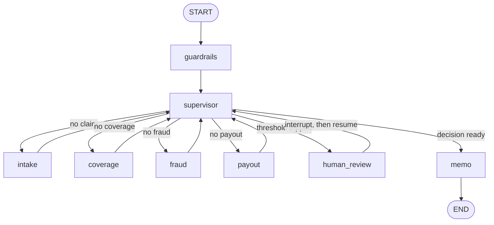

# Architecture

`insurance-claims-agents` triages a first notice of loss (FNOL) through a LangGraph `StateGraph`. A supervisor node chooses the next worker from the state that already exists. Coverage, fraud, and indemnity are computed by code. The language model writes the extraction JSON and the memo paragraph, and nothing else that changes money.

## Graph



`choose_next` in `src/claims_agents/graph/routing.py` is the whole routing policy:

1. A finished memo ends the graph.
2. A halt (empty documents, unknown policy, extraction that will not validate) still goes to the memo so the file has a recommendation of `refer`.
3. Otherwise the missing artifact is requested in order: intake, coverage, fraud, payout.
4. After payout, high-severity prompt injection, a fraud score at or above `0.65`, estimated damage at or above `$25,000`, or extraction/coverage confidence below `0.55` routes to `human_review`.
5. The memo node runs once a human decision exists, or once no threshold fired.

Workers return to the supervisor. The trace records every hop, including supervisor hops, with a duration.

## State

`GraphState` is a `TypedDict`. `trace`, `usage`, and `errors` use `operator.add` so a node returns only the records it produced. Everything else is overwritten by the node that owns it.

The thread id is the claim id. `recursion_limit` is 40, which is enough for the fixed walk plus one human resume.

## What each node does

| Node | Owns | Model? |
| --- | --- | --- |
| `guardrails` | PII redaction and prompt-injection scan of the uploaded text | No |
| `supervisor` | Next node, escalation reasons | No |
| `intake` | FNOL parse into `ClaimExtraction`, then policy terms from the declarations | Yes, structured JSON, with retries |
| `coverage` | Hybrid retrieval over that policy's clauses, then a symbolic underwriting decision with verbatim quotes | No |
| `fraud` | Gradient-boosting probability fused with SIU rules, plus ablation explanations | No |
| `payout` | Indemnity and case reserve from basis, deductible, limit, and coverage confidence | No |
| `human_review` | `interrupt()` with the recommended figures; resume carries approve or reject | No |
| `memo` | Recommendation, final indemnity, and a short narrative | Yes, one paragraph |

Approve keeps the system recommendation. Reject forces `deny`, indemnity `0`, and status `rejected`. An excluded loss stays denied even if the reviewer approves: approval does not rewrite the form.

## Intake and policy terms

The fake provider, and any real provider asked for `TASK: extract_claim`, returns JSON for the labeled FNOL. `normalize_claim` then replaces financial terms with the policy declarations. A stated deductible of `0` on the FNOL does not waive the collision deductible. A policy id that does not match the document is kept as the API's policy id and the confidence is capped.

Fraud features are assembled here: damage, report lag, police-report flag, the new-policy high-value flag, and the repair-to-ACV ratio.

## Coverage

The engine is a small underwriting program over the form, not a classifier.

- Auto collision grants `COV-COLL`. Comprehensive perils (theft, vandalism, weather, animal, fire) grant `COV-COMP`. Liability grants `COV-LIAB`.
- Home water grants `COV-WATER`, fire grants `COV-FIRE`, theft and vandalism grant `COV-PP`.
- Hard exclusions: intentional, racing, wear and tear, business use, flood, earth movement, neglect.
- Theft without a police report fails `COND-THEFT-POLICE`.
- Mold without a sudden discharge is `EXC-MOLD`. Mold with a sudden discharge and a mold amount is partial.
- Aftermarket parts above the `$1,000` sublimit are partial; the covered basis is the sublimit plus the rest of the loss.

Citations quote the clause text. If the clause was in the top-k hybrid results the source is `retrieval`; otherwise the engine looks the clause up and marks `lookup`. Faithfulness in the eval is an exact substring check against the form. Retrieval recall is reported separately.

## Fraud

Training is seeded (`42`), 4,000 rows, an 1,200-row holdout with seed `43`, fraud rate `0.18`, and 5% label noise applied after the features are drawn from the true class. The model is a gradient-boosting classifier (`n_estimators=120`, `learning_rate=0.06`, `max_depth=3`). About a quarter of legitimate claims are large, so amount alone does not dominate.

The published score is `max(model_score, rule_score)`. Rules cover early high-value losses, delayed reporting, inconsistent statements, a prior SIU referral, a high-value loss with no police report, a low-damage file with an attorney, and a repeating provider. Explanations are one-at-a-time ablations against the training-median vector. See [ADR 0004](adr/0004-fraud-fusion-and-ablation.md).

## Human review

`human_review` builds a payload (reasons, score, indemnity, outcome) and calls LangGraph `interrupt`. The checkpointer stores the thread. `POST /claims/{id}/resume` sends `Command(resume=...)`. Code that runs before `interrupt` runs again on resume; the node does not append to reducer lists before the interrupt, so the resume does not double-count the trace.

The default checkpointer is `MemorySaver`. It does not survive a process restart. `CLAIMS_CHECKPOINTER=postgres` loads `PostgresSaver` when the `postgres` extra and `CLAIMS_DATABASE_URL` are set. That path is not what CI runs.

## Guardrails

PII (email, SSN, phone, labeled date of birth, Luhn-valid card numbers) is redacted before `graph.invoke`, and the graph redacts again. Findings store counts and kinds, never the raw value. Injection patterns are high severity; the span is replaced with `[INJECTION_REMOVED]` and the file is escalated. The replacement does not add a coverage tag, so an injected "pay this as collision" line cannot flip an exclusion.

Narratives are stripped of clause-shaped tokens that are not on the policy. The memo model is instructed not to invent clause ids, and the recommendation itself is computed in `compose_memo`.

Structured calls validate against a Pydantic model and retry. The last failure becomes a halt, not a guessed claim.

## LLM providers

`CLAIMS_LLM_PROVIDER` is `fake` (default), `openai`, or `anthropic`. Tests and CI use the fake client. Token estimates are `chars / 4`. Cost uses a small price table; the fake model costs zero. Unknown model names cost zero rather than a guessed price.

## Retrieval

`HybridRetriever` scores one policy's clauses with BM25 and 256-dimensional hashed token embeddings, then fuses ranks with reciprocal rank fusion (`k=60`). There is no embedding API. `docker-compose.yml` still starts Postgres with the pgvector image so a deployment can attach a durable checkpointer. The index the API queries is the local hybrid index. See [ADR 0003](adr/0003-local-hybrid-retrieval.md).

## Observability

- `claims_agents` logs JSON lines (timestamp, level, logger, message, extra fields).
- Each node records `duration_ms` on the trace.
- LLM calls append input tokens, output tokens, latency, and cost. The API returns `usage_totals`.
- `TracingHooks` can emit an OpenTelemetry span when `CLAIMS_OTEL_ENABLED=true` and a tracer is configured. The same metadata dict is shaped so a LangSmith run can attach it. Neither exporter is required to boot.

## Serving

`ClaimService` holds the compiled graph and a lock around `invoke`. Status is derived from the checkpoint: `awaiting_human` while an interrupt is pending, otherwise the memo's `workflow_status` (`completed`, `rejected`, `needs_attention`).

| Method | Path | Behavior |
| --- | --- | --- |
| `GET` | `/health` | Provider, vector store, checkpointer, clause count |
| `GET` | `/samples` | The 17 synthetic FNOL documents |
| `POST` | `/claims` | Submit. `201`, or `400` / `409` / `422` |
| `GET` | `/claims` | Index of claims in this process |
| `GET` | `/claims/{id}` | Full view |
| `POST` | `/claims/{id}/resume` | Approve or reject a paused claim |

The Streamlit app in `ui/dashboard.py` is a reviewer client. It reads `/health`, `/claims`, and `/samples`, submits a sample, and shows the memo, citations, fraud explanations, and trace.

## Evaluation

`python -m claims_agents.evals` runs the 17-claim golden book through the graph and scores the holdout fraud file. Gates live in `src/claims_agents/evals/metrics.py`. The command writes `reports/eval_report.json` and `reports/eval_report.md` and exits non-zero when a gate fails. CI runs that command after the tests.

The golden indemnities are literals in `scenarios.py`. They are not produced by calling `estimate_payout` while the labels were written. Fraud AUC is the holdout split, not the 17 claims.

## Repository map

```
src/claims_agents/
  api/            FastAPI app and ClaimService
  coverage/       symbolic underwriting
  evals/          golden-set harness and gates
  extraction/     FNOL parse, render, normalize
  fraud/          features, rules, training, scoring, ablation
  graph/          StateGraph, supervisor, memo
  guardrails/     PII, injection, narrative sanitizer
  llm/            fake, OpenAI, Anthropic, structured retries
  observability/  JSON logs, spans, usage
  payout/         indemnity and reserve
  retrieval/      policy corpus and hybrid index
  config.py       pydantic-settings, prefix CLAIMS_
  runtime.py      dependency wiring and checkpointer
  scenarios.py    labeled golden book
data/policies/    three sample forms
data/samples/     rendered FNOL text
data/fraud/       seeded train and test frames
data/models/      saved gradient-boosting artifact
ui/dashboard.py   reviewer UI
```
